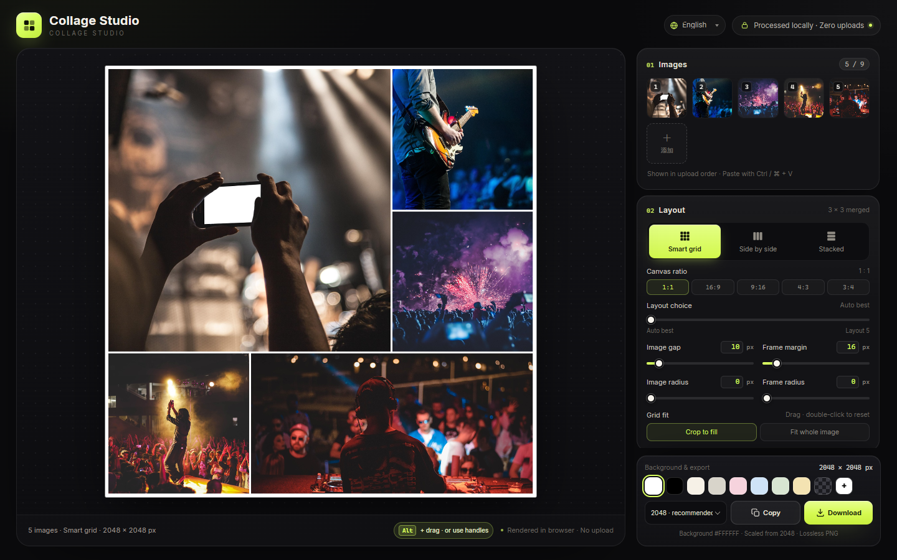

# Collage Studio

**English** · [简体中文](docs/README.zh-CN.md) · [日本語](docs/README.ja.md) · [한국어](docs/README.ko.md) · [Español](docs/README.es.md) · [Deutsch](docs/README.de.md) · [Français](docs/README.fr.md) · [Português](docs/README.pt.md) · [العربية](docs/README.ar.md)

A **browser-only, zero-dependency** collage maker built from four static files (`index.html`, `styles.css`, `app.js`, `i18n.js`). Open `index.html` to run — no install, no build, no upload. Images never leave your device.

**Try it:** [https://collage.stevenpub.com](https://collage.stevenpub.com)



## Examples

Actual exports at a 1600 px long edge with default settings.

<div align="center">
<table>
  <tr>
    <td align="center" valign="top"><br><sub><b>Smart grid · 1:1</b></sub></td>
    <td align="center" valign="top"><br><sub><b>Smart grid · 16:9</b></sub></td>
  </tr>
</table>
</div>

<p align="center"><br><sub><b>Side by side</b></sub></p>

## Layouts (1:1)

Five images, one square canvas — pick any of the layout candidates with the **Layout choice** slider.

<div align="center">
<table>
  <tr>
    <td align="center" valign="top"><a href="docs/images/example-layout-auto.jpg"></a><br><sub><b>Auto best</b></sub></td>
    <td align="center" valign="top"><a href="docs/images/example-layout-1.jpg"></a><br><sub><b>Layout 1</b></sub></td>
    <td align="center" valign="top"><a href="docs/images/example-layout-2.jpg"></a><br><sub><b>Layout 2</b></sub></td>
    <td align="center" valign="top"><a href="docs/images/example-layout-3.jpg"></a><br><sub><b>Layout 3</b></sub></td>
  </tr>
</table>
</div>

## Quick start

1. Open `index.html` in Chrome / Edge (keep the four files in the same folder).
2. Add up to **9 images**: click **Choose images**, drag photos onto the page, or paste with `Ctrl / ⌘ + V`.
3. Pick a layout — **Smart grid**, **Side by side** or **Stacked**. The grid also offers canvas ratios `1:1 / 16:9 / 9:16 / 4:3 / 3:4`.
4. Tune gap, frame margin, image radius, frame radius and background. In the grid, drag an image to choose its crop, or double-click to re-center.
5. Click **Copy** to put the PNG on the clipboard, or **Download** to save it.

Thumbnails reorder by dragging, `‹` `›` on hover, or `×` to remove one.

## Features

- **Three layouts** — Smart grid uses merged 3×3 templates for 1–9 images, always filling the canvas with a magazine-style one-big-several-small composition. Side by side and Stacked place images in one row/column at their own aspect ratio, without cropping.
- **Five canvas ratios** — `1:1 / 16:9 / 9:16 / 4:3 / 3:4`. The long edge stays fixed, so 2048 px gives 2048 × 1152 for 16:9 and 1152 × 2048 for 9:16.
- **Layout choice** — slider `0` is auto best; `1–5` are other layouts ranked by crop retention. Reordering images never changes the layout; adding/removing images or moving the slider recalculates it.
- **Reordering** — each cell has a top-right handle. All handles appear when the pointer enters the canvas and fade 1 s after leaving; the first visit shows them for 5 s, and a tap shows them for 1 s on touch. Drag a handle, or hold `Alt` and drag a cell on desktop.
- **Live preview** — dark stage, transparent backgrounds shown as a grey checkerboard, 1 px canvas outline (preview only, never exported).
- **Privacy** — everything runs in the browser: no network requests, no uploads, no third-party scripts.

## Parameters

| Setting | Range | Notes |
|---|---|---|
| Image gap | `0–120 px` | Space between images |
| Frame margin | `0–160 px` | Actual distance from canvas edge to images; no extra gap added |
| Image radius | `0–120 px` | Clamped to half the cell |
| Frame radius | `0–240 px` | Whole-collage rounding; outside is exported transparent |
| Background | White by default | 8 presets, custom picker, transparent |
| Grid fit | Crop to fill / Fit whole | Crop: drag to reposition, double-click to reset |

All values accept direct input (`Enter` or blur applies), stay in sync with their sliders, and clamp out-of-range input.

## Export

Long edge **1200 / 1600 / 2048 / 2560 / 3072 / 4096 px**, lossless PNG. Copy to clipboard or download; transparency and the area outside the frame radius are preserved.

`1200` chat · `1600` web · `2048` recommended · `2560` 2K · `3072` print · `4096` poster

> Copying needs the browser Clipboard API. If unavailable or blocked, use **Download**.

## Units

Gap, margins and radii use a **2048 px long edge** as the design baseline and scale with the export size, so the composition is identical at every resolution — only the output size changes. A baseline `16 px` frame margin becomes `32 px` at 4096 px and about `9.4 px` at 1200 px.

## Files

```
index.html   # page structure
styles.css   # all styles
i18n.js      # UI strings (zh / en / ja / ko / es / de / fr)
app.js       # layout, rendering, interaction, export
preview.png  # social preview (English UI)
docs/        # README per language + localized screenshots
```
