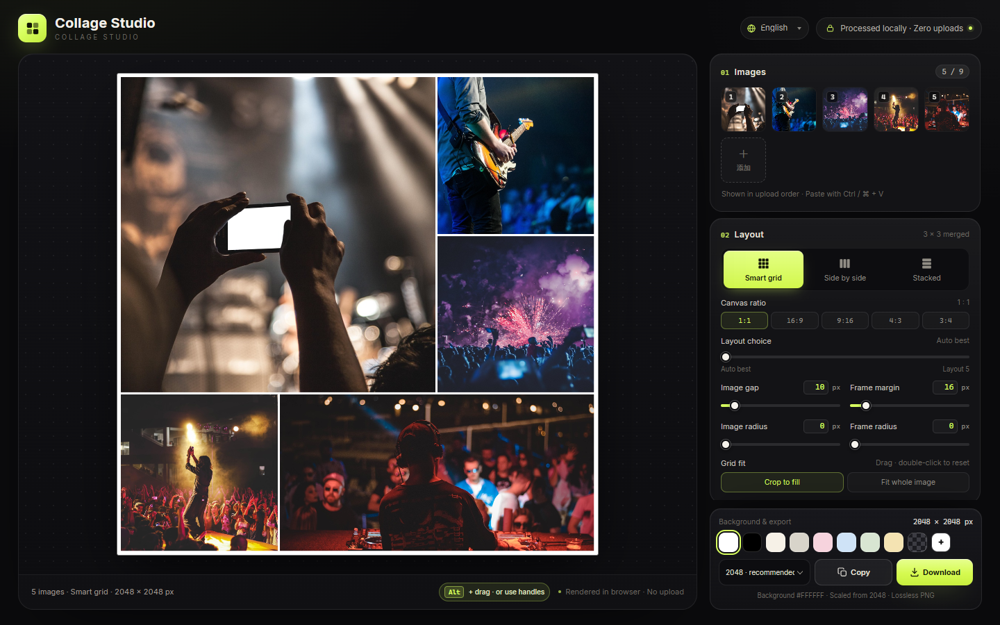

# Collage Studio

[English](../README.md) · [简体中文](README.zh-CN.md) · [日本語](README.ja.md) · [한국어](README.ko.md) · [Español](README.es.md) · [Deutsch](README.de.md) · [Français](README.fr.md) · [Português](README.pt.md) · **العربية**

أداة كولاج **تعمل في المتصفح فقط ومن دون أي اعتماديات**، مبنية من أربعة ملفات ثابتة (`index.html` و`styles.css` و`app.js` و`i18n.js`). افتح `index.html` للتشغيل — بلا تثبيت ولا بناء ولا رفع. الصور لا تغادر جهازك أبدًا.

**جرّبها عبر الإنترنت:** [https://collage.stevenpub.com](https://collage.stevenpub.com)



## أمثلة

صادرات فعلية بحافة طويلة مقدارها 1600 بكسل وبالإعدادات الافتراضية.

<div align="center">
<table>
  <tr>
    <td align="center" valign="top"><br><sub><b>شبكة ذكية · 1:1</b></sub></td>
    <td align="center" valign="top"><br><sub><b>شبكة ذكية · 16:9</b></sub></td>
  </tr>
</table>
</div>

<p align="center"><br><sub><b>جنبًا إلى جنب</b></sub></p>

## التخطيطات (1:1)

خمس صور ولوحة مربعة واحدة — اختر أي مرشح باستخدام منزلق **اختيار التخطيط**.

<div align="center">
<table>
  <tr>
    <td align="center" valign="top"><a href="images/example-layout-auto.jpg"></a><br><sub><b>الأفضل تلقائيًا</b></sub></td>
    <td align="center" valign="top"><a href="images/example-layout-1.jpg"></a><br><sub><b>التخطيط 1</b></sub></td>
    <td align="center" valign="top"><a href="images/example-layout-2.jpg"></a><br><sub><b>التخطيط 2</b></sub></td>
    <td align="center" valign="top"><a href="images/example-layout-3.jpg"></a><br><sub><b>التخطيط 3</b></sub></td>
  </tr>
</table>
</div>

## البدء السريع

1. افتح `index.html` في Chrome أو Edge (أبقِ الملفات الأربعة في المجلد نفسه).
2. أضف حتى **9 صور**: انقر **اختيار الصور**، أو اسحب الصور إلى الصفحة، أو الصقها بـ `Ctrl / ⌘ + V`.
3. اختر تخطيطًا — **شبكة ذكية** أو **جنبًا إلى جنب** أو **متراص**. توفر الشبكة أيضًا نسب اللوحة `1:1 / 16:9 / 9:16 / 4:3 / 3:4`.
4. اضبط الفاصل وهامش الإطار ونصف قطر الصورة ونصف قطر الإطار والخلفية. في الشبكة، اسحب الصورة لاختيار القص، أو انقر نقرًا مزدوجًا لإعادة التوسيط.
5. انقر **نسخ** لوضع ملف PNG في الحافظة، أو **تنزيل** لحفظه.

تُعاد ترتيب الصور المصغرة بالسحب، أو بـ `‹` `›` عند التمرير، أو بـ `×` لحذف واحدة.

## الميزات

- **ثلاثة تخطيطات** — تستخدم الشبكة الذكية قوالب 3×3 مدمجة لعدد من 1 إلى 9 صور، وتملأ اللوحة دائمًا بتكوين أشبه بالمجلة: صورة كبيرة وعدة صور صغيرة. يضع التخطيطان جنبًا إلى جنب والمتراص الصور في صف أو عمود واحد بنسبة أبعادها الأصلية، من دون قص.
- **خمس نسب للوحة** — `1:1 / 16:9 / 9:16 / 4:3 / 3:4`. تبقى الحافة الطويلة ثابتة، لذا يعطي 2048 بكسل مقاس 2048 × 1152 لنسبة 16:9 و1152 × 2048 لنسبة 9:16.
- **اختيار التخطيط** — القيمة `0` هي الأفضل تلقائيًا؛ و`1–5` تخطيطات أخرى مرتبة حسب المساحة المحفوظة. إعادة ترتيب الصور لا تغيّر التخطيط؛ أما إضافة الصور أو حذفها أو تحريك المنزلق فيعيد الحساب.
- **إعادة الترتيب** — لكل خلية مقبض في الزاوية العلوية. تظهر كل المقابض عند دخول المؤشر منطقة اللوحة وتتلاشى بعد ثانية من المغادرة؛ وتظهر 5 ثوانٍ في الزيارة الأولى، وثانية واحدة عند النقر على الشاشة اللمسية. اسحب مقبضًا، أو اضغط `Alt` واسحب خلية على الحاسوب.
- **معاينة مباشرة** — منصة داكنة، والخلفيات الشفافة تظهر كرقعة شطرنج رمادية، مع حد بمقدار 1 بكسل حول اللوحة (للمعاينة فقط ولا يُصدَّر).
- **الخصوصية** — كل المعالجة تتم داخل المتصفح: بلا طلبات شبكة ولا رفع ولا نصوص من أطراف ثالثة.

## الإعدادات

| الإعداد | النطاق | ملاحظات |
|---|---|---|
| فاصل الصور | `0–120 px` | المسافة بين الصور |
| هامش الإطار | `0–160 px` | المسافة الفعلية من حافة اللوحة إلى الصور؛ لا يُضاف نصف فاصل إضافي |
| نصف قطر الصورة | `0–120 px` | يُقيَّد بنصف الخلية |
| نصف قطر الإطار | `0–240 px` | تدوير الكولاج كله؛ ما خارجه يُصدَّر شفافًا |
| الخلفية | بيضاء افتراضيًا | 8 إعدادات مسبقة، منتقي مخصص، وشفاف |
| ملاءمة الشبكة | قص للملء / إظهار الصورة كاملة | عند القص: اسحب لتغيير الموضع، وانقر نقرًا مزدوجًا للإعادة |

تقبل كل القيم الإدخال المباشر (يُطبَّق بـ `Enter` أو عند مغادرة الحقل)، وتبقى متزامنة مع المنزلقات، وتُقيَّد إذا خرجت عن النطاق.

## التصدير

الحافة الطويلة **1200 / 1600 / 2048 / 2560 / 3072 / 4096 px**، بصيغة PNG من دون فقدان. انسخ إلى الحافظة أو نزّل؛ تُحفظ الشفافية والمنطقة خارج نصف قطر الإطار.

`1200` دردشة · `1600` ويب · `2048` موصى به · `2560` ‏2K · `3072` طباعة · `4096` ملصق

> النسخ يحتاج واجهة الحافظة في المتصفح. إذا لم تتوفر أو حُجبت، استخدم **تنزيل**.

## الوحدات

يستخدم الفاصل والهوامش وأنصاف الأقطار **حافة طويلة بمقدار 2048 px** كأساس للتصميم، وتتكيف مع حجم التصدير، فيبقى التكوين نفسه في كل دقة ولا يتغير إلا حجم الملف. هامش إطار أساسي مقداره `16 px` يصبح `32 px` عند 4096 بكسل ونحو `9.4 px` عند 1200 بكسل.

## الملفات

```
index.html   # بنية الصفحة
styles.css   # كل الأنماط
i18n.js      # نصوص الواجهة (zh / en / ja / ko / es / de / fr)
app.js       # التخطيط والعرض والتفاعل والتصدير
preview.png  # معاينة المشاركة (واجهة إنجليزية)
docs/        # ملف README لكل لغة ولقطات الواجهة
```
