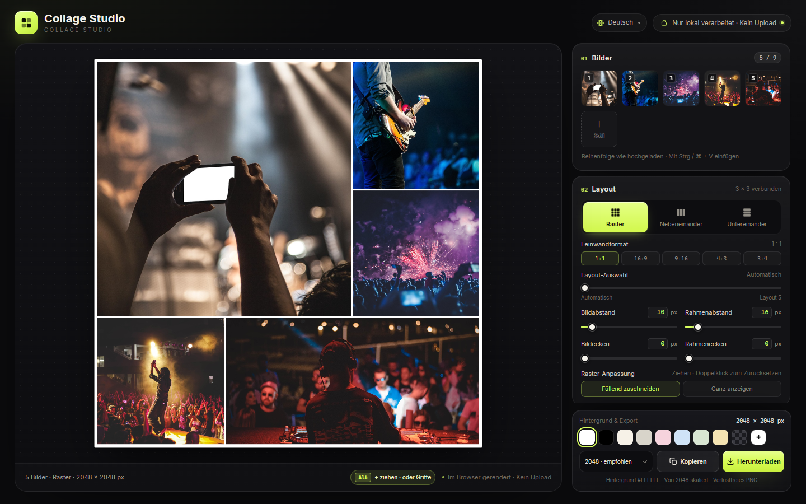
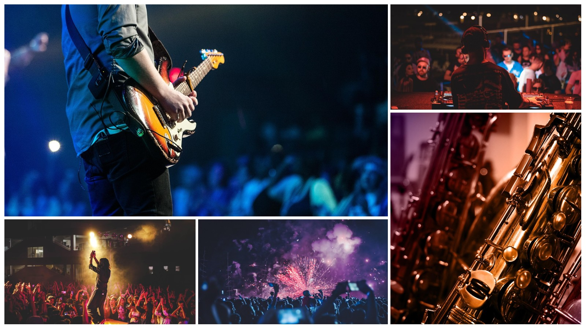
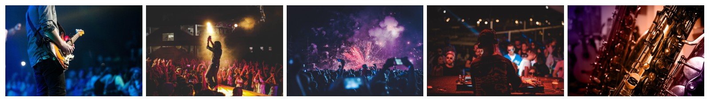
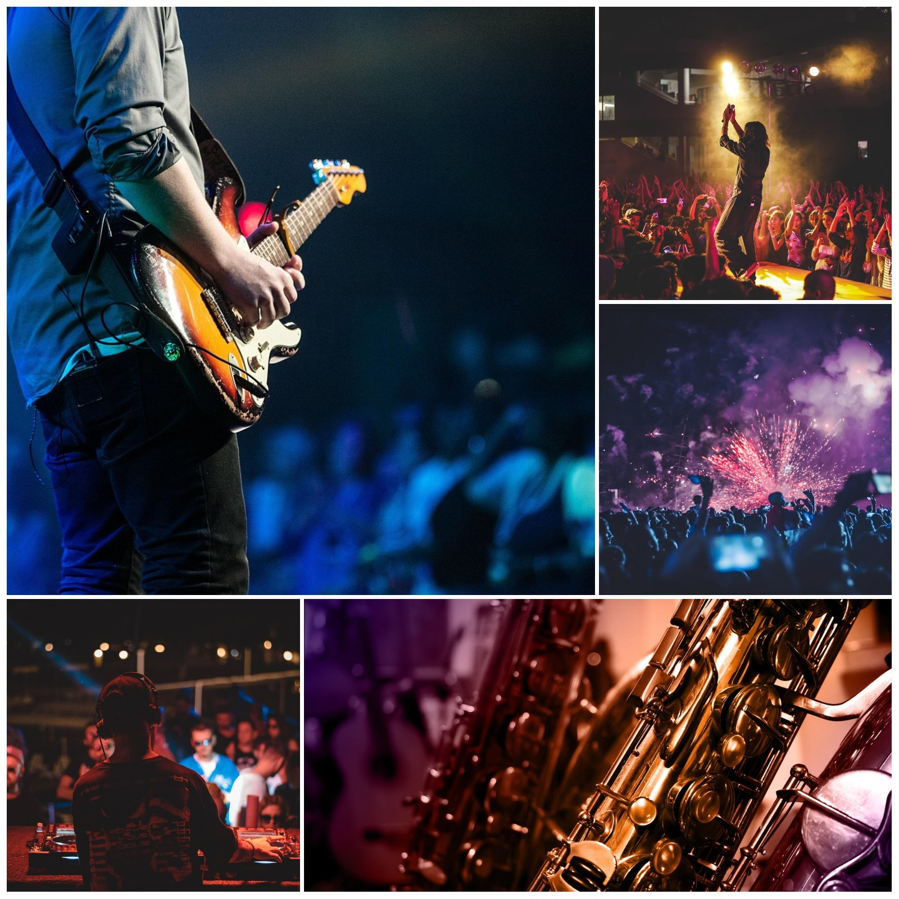
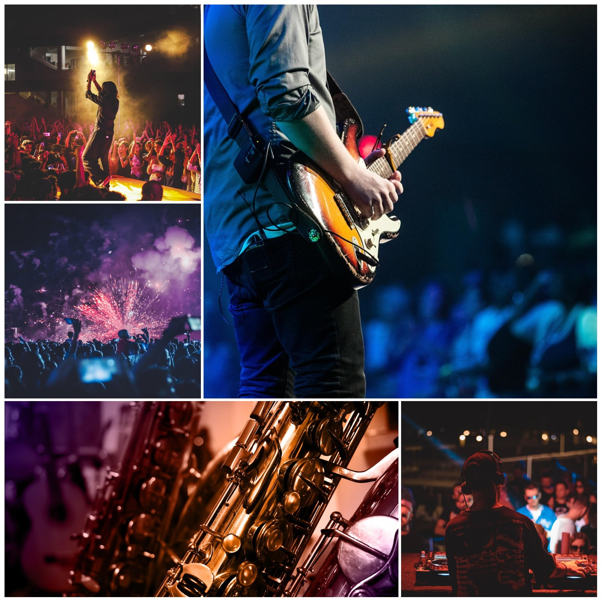
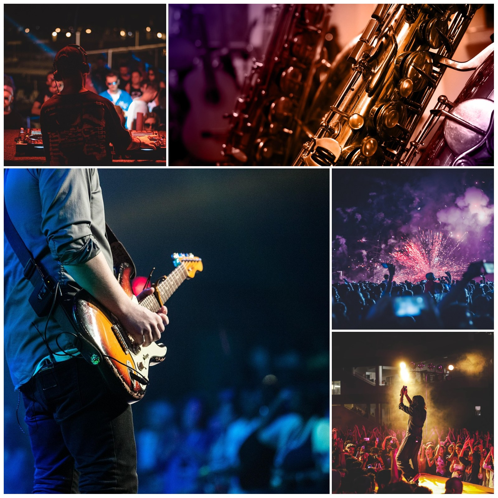
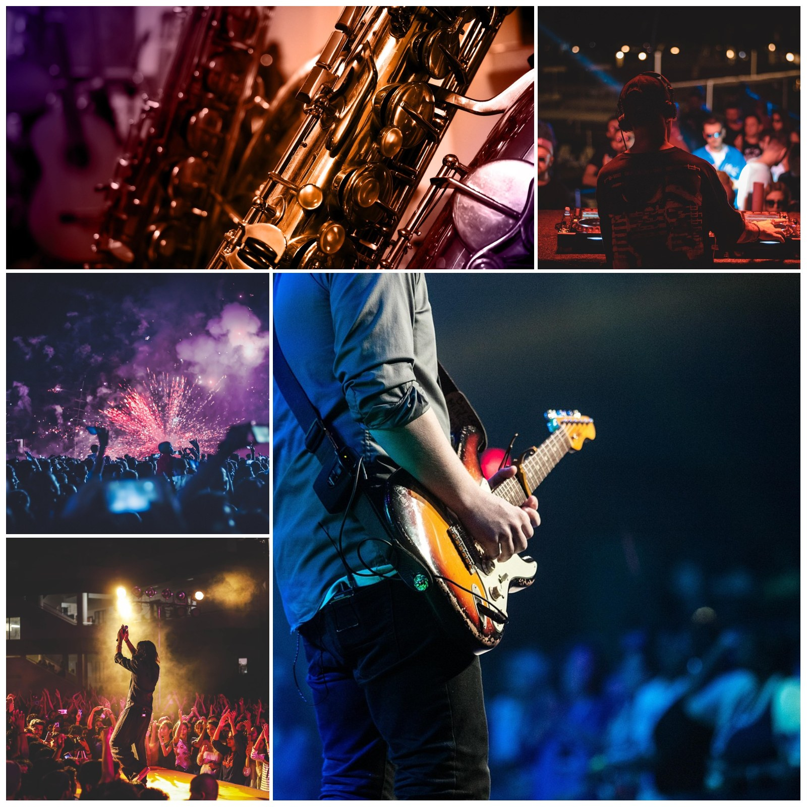

# Collage Studio

[English](../README.md) · [简体中文](README.zh-CN.md) · [日本語](README.ja.md) · [한국어](README.ko.md) · [Español](README.es.md) · **Deutsch** · [Français](README.fr.md)

Ein **reines Browser-Tool ohne Abhängigkeiten** zum Erstellen von Collagen. Vier statische Dateien (`index.html`, `styles.css`, `app.js`, `i18n.js`) — `index.html` öffnen und loslegen, ohne Installation und ohne Build. Bilder verlassen das Gerät nie.



## Beispiele

Echte Exporte mit 1600 px langer Kante und Standardeinstellungen.

<div align="center">
<table>
  <tr>
    <td align="center" valign="top"><br><sub><b>Raster · 1:1</b></sub></td>
    <td align="center" valign="top"><br><sub><b>Raster · 16:9</b></sub></td>
  </tr>
</table>
</div>

<p align="center"><br><sub><b>Nebeneinander</b></sub></p>

## Layouts (1:1)

Dieselben 5 Bilder auf quadratischer Leinwand — der Regler **Layout-Auswahl** wechselt zwischen den Kandidaten.

<div align="center">
<table>
  <tr>
    <td align="center" valign="top"><a href="images/example-layout-auto.jpg"></a><br><sub><b>Automatisch</b></sub></td>
    <td align="center" valign="top"><a href="images/example-layout-1.jpg"></a><br><sub><b>Layout 1</b></sub></td>
    <td align="center" valign="top"><a href="images/example-layout-2.jpg"></a><br><sub><b>Layout 2</b></sub></td>
    <td align="center" valign="top"><a href="images/example-layout-3.jpg"></a><br><sub><b>Layout 3</b></sub></td>
  </tr>
</table>
</div>

## Schnellstart

1. `index.html` in Chrome / Edge öffnen (alle vier Dateien im selben Ordner).
2. Bis zu **9 Bilder** hinzufügen: **Bilder wählen**, Fotos auf die Seite ziehen oder mit `Ctrl / ⌘ + V` einfügen.
3. Layout wählen: **Raster**, **Nebeneinander** oder **Untereinander**. Das Raster bietet zusätzlich die Formate `1:1 / 16:9 / 9:16 / 4:3 / 3:4`.
4. Abstand, Rahmenabstand, Bildecken, Rahmenecken und Hintergrund anpassen. Im Raster ein Bild ziehen, um den Zuschnitt zu wählen, oder per Doppelklick zentrieren.
5. **Kopieren** legt das PNG in die Zwischenablage, **Herunterladen** speichert die Datei.

Miniaturen lassen sich per Ziehen sortieren, mit `‹` `›` beim Überfahren verschieben und mit `×` einzeln löschen.

## Funktionen

- **Drei Layouts** — Das Raster nutzt verbundene 3×3-Vorlagen für 1–9 Bilder und füllt die Leinwand immer mit einer magazinartigen Komposition aus einem großen und mehreren kleinen Bildern. Nebeneinander und Untereinander setzen die Bilder in einer Zeile/Spalte im eigenen Seitenverhältnis um, ohne Zuschnitt.
- **Fünf Formate** — `1:1 / 16:9 / 9:16 / 4:3 / 3:4`. Die lange Kante bleibt fest: 2048 px ergeben 2048 × 1152 bei 16:9 und 1152 × 2048 bei 9:16.
- **Layout-Auswahl** — Regler `0` ist automatisch, `1–5` sind weitere Layouts nach Zuschnitt-Ausbeute. Umsortieren ändert das Layout nicht; neu berechnet wird beim Hinzufügen/Entfernen von Bildern oder Bewegen des Reglers.
- **Umsortieren** — Jede Zelle hat oben rechts einen Griff. Alle Griffe erscheinen beim Betreten der Leinwand und blenden 1 s nach dem Verlassen aus; beim ersten Besuch 5 s, per Touch 1 s nach einem Tippen. Griff ziehen oder am Desktop `Alt` + Zelle ziehen.
- **Live-Vorschau** — Dunkle Bühne, transparente Hintergründe als graues Schachbrett, 1-px-Kontur der Leinwand (nur Vorschau, nie im Export).
- **Datenschutz** — Alles läuft im Browser: keine Netzwerkanfragen, keine Uploads, keine Skripte von Drittanbietern.

## Parameter

| Einstellung | Bereich | Hinweise |
|---|---|---|
| Bildabstand | `0–120 px` | Abstand zwischen den Bildern |
| Rahmenabstand | `0–160 px` | Tatsächlicher Abstand von Leinwandkante zu Bildern; nichts wird addiert |
| Bildecken | `0–120 px` | Auf die halbe Zelle begrenzt |
| Rahmenecken | `0–240 px` | Rundung der gesamten Collage; außen transparent |
| Hintergrund | Standard Weiß | 8 Presets, eigene Farbe, transparent |
| Raster-Anpassung | Füllend zuschneiden / Ganz anzeigen | Beim Zuschneiden ziehen, Doppelklick setzt zurück |

Alle Werte lassen sich eintippen (`Enter` oder Fokusverlust), sind mit den Reglern synchron und werden außerhalb des Bereichs korrigiert.

## Export

Lange Kante **1200 / 1600 / 2048 / 2560 / 3072 / 4096 px**, verlustfreies PNG. In die Zwischenablage kopieren oder herunterladen; Transparenz und der Bereich außerhalb der Rahmenecken bleiben erhalten.

`1200` Chat · `1600` Web · `2048` empfohlen · `2560` 2K · `3072` Druck · `4096` Poster

> Das Kopieren nutzt die Clipboard-API des Browsers. Wenn sie fehlt oder blockiert ist, bitte **Herunterladen** verwenden.

## Einheiten

Abstand, Ränder und Ecken beziehen sich auf eine **lange Kante von 2048 px** und skalieren mit der Exportgröße. Die Komposition bleibt also bei jeder Auflösung gleich, nur die Ausgabegröße ändert sich. Ein Rahmenabstand von `16 px` ergibt `32 px` bei 4096 px und etwa `9.4 px` bei 1200 px.

## Dateien

```
index.html   # Seitenstruktur
styles.css   # alle Styles
i18n.js      # Oberflächentexte (zh / en / ja / ko / es / de / fr)
app.js       # Layout, Rendering, Interaktion, Export
docs/        # README je Sprache und Screenshots
```
