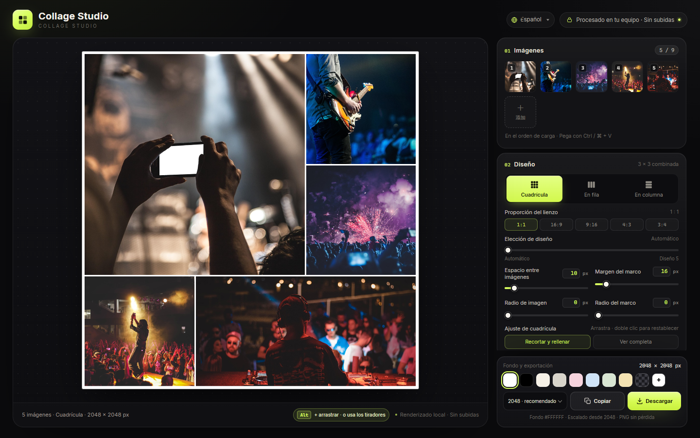

# Collage Studio

[English](../README.md) · [简体中文](README.zh-CN.md) · [日本語](README.ja.md) · [한국어](README.ko.md) · **Español** · [Deutsch](README.de.md) · [Français](README.fr.md) · [Português](README.pt.md) · [العربية](README.ar.md)

Un editor de collage **que funciona solo en el navegador y sin dependencias**. Son cuatro archivos estáticos (`index.html`, `styles.css`, `app.js`, `i18n.js`): abre `index.html` y listo, sin instalación ni compilación. Tus imágenes nunca salen del dispositivo.

**Probar en línea:** [https://collage.stevenpub.com](https://collage.stevenpub.com)



## Ejemplos

Exportaciones reales a 1600 px de lado largo con los ajustes predeterminados.

<div align="center">
<table>
  <tr>
    <td align="center" valign="top"><br><sub><b>Cuadrícula · 1:1</b></sub></td>
    <td align="center" valign="top"><br><sub><b>Cuadrícula · 16:9</b></sub></td>
  </tr>
</table>
</div>

<p align="center"><br><sub><b>En fila</b></sub></p>

## Diseños (1:1)

Las mismas 5 imágenes en un lienzo cuadrado: el control **Elección de diseño** cambia entre candidatos.

<div align="center">
<table>
  <tr>
    <td align="center" valign="top"><a href="images/example-layout-auto.jpg"></a><br><sub><b>Automático</b></sub></td>
    <td align="center" valign="top"><a href="images/example-layout-1.jpg"></a><br><sub><b>Diseño 1</b></sub></td>
    <td align="center" valign="top"><a href="images/example-layout-2.jpg"></a><br><sub><b>Diseño 2</b></sub></td>
    <td align="center" valign="top"><a href="images/example-layout-3.jpg"></a><br><sub><b>Diseño 3</b></sub></td>
  </tr>
</table>
</div>

## Inicio rápido

1. Abre `index.html` en Chrome / Edge (mantén los cuatro archivos en la misma carpeta).
2. Añade hasta **9 imágenes**: pulsa **Elegir imágenes**, arrastra fotos a la página o pega con `Ctrl / ⌘ + V`.
3. Elige el diseño: **Cuadrícula**, **En fila** o **En columna**. La cuadrícula ofrece además proporciones `1:1 / 16:9 / 9:16 / 4:3 / 3:4`.
4. Ajusta espacio, margen del marco, radio de imagen, radio del marco y fondo. En la cuadrícula, arrastra una imagen para elegir el recorte o haz doble clic para recentrar.
5. Pulsa **Copiar** para llevar el PNG al portapapeles o **Descargar** para guardarlo.

Las miniaturas se reordenan arrastrando, con `‹` `›` al pasar el cursor, y `×` elimina una imagen.

## Funciones

- **Tres diseños** — La cuadrícula usa plantillas 3×3 combinadas para 1–9 imágenes y siempre llena el lienzo con una composición tipo revista de una imagen grande y varias pequeñas. En fila y En columna las imágenes van en una sola fila/columna a su propia proporción, sin recortes.
- **Cinco proporciones** — `1:1 / 16:9 / 9:16 / 4:3 / 3:4`. El lado largo es fijo: 2048 px da 2048 × 1152 en 16:9 y 1152 × 2048 en 9:16.
- **Elección de diseño** — El control `0` es automático; `1–5` son otros diseños ordenados por conservación del recorte. Reordenar imágenes no cambia el diseño; se recalcula al añadir o quitar imágenes o mover el control.
- **Reordenar** — Cada celda tiene un tirador arriba a la derecha. Todos aparecen al entrar con el puntero en el lienzo y se desvanecen 1 s después de salir; la primera visita los muestra 5 s y, en táctil, un toque los muestra 1 s. Arrastra un tirador o mantén `Alt` y arrastra una celda en escritorio.
- **Vista previa en vivo** — Escenario oscuro, fondos transparentes como tablero gris y borde de 1 px en el lienzo (solo vista previa, nunca se exporta).
- **Privacidad** — Todo se ejecuta en el navegador: sin peticiones de red, sin subidas y sin scripts de terceros.

## Parámetros

| Ajuste | Rango | Notas |
|---|---|---|
| Espacio entre imágenes | `0–120 px` | Separación entre imágenes |
| Margen del marco | `0–160 px` | Distancia real del borde del lienzo a las imágenes; no se suma nada |
| Radio de imagen | `0–120 px` | Limitado a la mitad de la celda |
| Radio del marco | `0–240 px` | Redondeo de todo el collage; el exterior se exporta transparente |
| Fondo | Blanco por defecto | 8 preajustes, color personalizado, transparente |
| Ajuste de cuadrícula | Recortar y rellenar / Ver completa | Al recortar, arrastra para colocar; doble clic para restablecer |

Todos los valores admiten entrada directa (`Enter` o perder el foco), están sincronizados con sus controles y corrigen los valores fuera de rango.

## Exportación

Lado largo **1200 / 1600 / 2048 / 2560 / 3072 / 4096 px**, PNG sin pérdida. Copia al portapapeles o descarga; la transparencia y el exterior del radio del marco se conservan.

`1200` chat · `1600` web · `2048` recomendado · `2560` 2K · `3072` impresión · `4096` póster

> Copiar depende de la Clipboard API del navegador. Si no está disponible o está bloqueada, usa **Descargar**.

## Unidades

El espacio, los márgenes y los radios usan un **lado largo de 2048 px** como base y se escalan con el tamaño de exportación, así que la composición es idéntica en cualquier resolución y solo cambia el tamaño de salida. Un margen base de `16 px` pasa a `32 px` en 4096 px y a unos `9.4 px` en 1200 px.

## Archivos

```
index.html   # estructura de la página
styles.css   # todos los estilos
i18n.js      # textos de la interfaz (zh / en / ja / ko / es / de / fr)
app.js       # diseño, renderizado, interacción y exportación
docs/        # README por idioma y capturas
```
