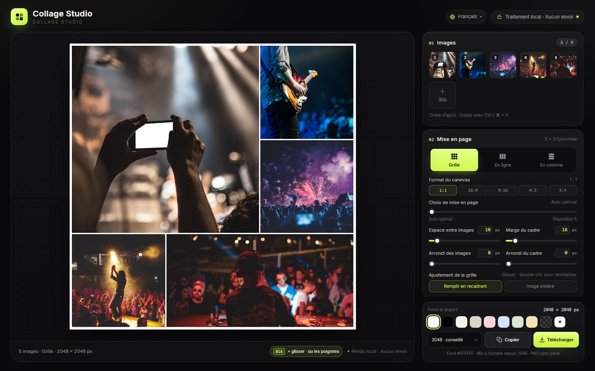

# Collage Studio

[English](../README.md) · [简体中文](README.zh-CN.md) · [日本語](README.ja.md) · [한국어](README.ko.md) · [Español](README.es.md) · [Deutsch](README.de.md) · **Français**

Un outil de collage **100 % navigateur, sans dépendance**. Quatre fichiers statiques (`index.html`, `styles.css`, `app.js`, `i18n.js`) : ouvrez `index.html` et c’est parti, sans installation ni compilation. Vos images ne quittent jamais l’appareil.



## Exemples

Exports réels à 1600 px de grand côté avec les réglages par défaut.

<div align="center">
<table>
  <tr>
    <td align="center" valign="top"><br><sub><b>Grille · 1:1</b></sub></td>
    <td align="center" valign="top"><br><sub><b>Grille · 16:9</b></sub></td>
  </tr>
</table>
</div>

<p align="center"><br><sub><b>En ligne</b></sub></p>

## Dispositions (1:1)

Les mêmes 5 images sur un canevas carré : le curseur **Choix de mise en page** change de candidat.

<div align="center">
<table>
  <tr>
    <td align="center" valign="top"><a href="images/example-layout-auto.jpg"></a><br><sub><b>Auto optimal</b></sub></td>
    <td align="center" valign="top"><a href="images/example-layout-1.jpg"></a><br><sub><b>Disposition 1</b></sub></td>
    <td align="center" valign="top"><a href="images/example-layout-2.jpg"></a><br><sub><b>Disposition 2</b></sub></td>
    <td align="center" valign="top"><a href="images/example-layout-3.jpg"></a><br><sub><b>Disposition 3</b></sub></td>
  </tr>
</table>
</div>

## Démarrage rapide

1. Ouvrez `index.html` dans Chrome / Edge (gardez les quatre fichiers dans le même dossier).
2. Ajoutez jusqu’à **9 images** : **Choisir des images**, glissez des photos sur la page ou collez avec `Ctrl / ⌘ + V`.
3. Choisissez la disposition : **Grille**, **En ligne** ou **En colonne**. La grille propose aussi les formats `1:1 / 16:9 / 9:16 / 4:3 / 3:4`.
4. Réglez l’espace, la marge du cadre, l’arrondi des images, l’arrondi du cadre et le fond. Dans la grille, faites glisser une image pour choisir le recadrage, ou double-cliquez pour recentrer.
5. **Copier** place le PNG dans le presse-papiers, **Télécharger** enregistre le fichier.

Les vignettes se réordonnent en glissant, avec `‹` `›` au survol, et `×` supprime une image.

## Fonctionnalités

- **Trois dispositions** — La grille utilise des gabarits 3×3 fusionnés pour 1 à 9 images et remplit toujours le canevas avec une composition façon magazine, une grande image et plusieurs petites. En ligne et En colonne placent les images sur une seule ligne/colonne à leur propre ratio, sans recadrage.
- **Cinq formats** — `1:1 / 16:9 / 9:16 / 4:3 / 3:4`. Le grand côté reste fixe : 2048 px donnent 2048 × 1152 en 16:9 et 1152 × 2048 en 9:16.
- **Choix de mise en page** — Le curseur `0` est automatique ; `1–5` sont d’autres dispositions classées par conservation du recadrage. Réordonner les images ne change pas la disposition ; elle est recalculée à l’ajout/suppression d’images ou au déplacement du curseur.
- **Réordonner** — Chaque cellule a une poignée en haut à droite. Toutes apparaissent quand le pointeur entre dans le canevas et s’effacent 1 s après la sortie ; à la première visite 5 s, et au tactile 1 s après un appui. Glissez une poignée, ou maintenez `Alt` et glissez une cellule sur ordinateur.
- **Aperçu en direct** — Scène sombre, fonds transparents en damier gris, contour de 1 px sur le canevas (aperçu uniquement, jamais exporté).
- **Confidentialité** — Tout se passe dans le navigateur : aucune requête réseau, aucun envoi, aucun script tiers.

## Paramètres

| Réglage | Plage | Remarques |
|---|---|---|
| Espace entre images | `0–120 px` | Espacement entre les images |
| Marge du cadre | `0–160 px` | Distance réelle du bord du canevas aux images ; rien n’est ajouté |
| Arrondi des images | `0–120 px` | Limité à la moitié de la cellule |
| Arrondi du cadre | `0–240 px` | Arrondi de tout le collage ; l’extérieur est exporté transparent |
| Fond | Blanc par défaut | 8 préréglages, couleur personnalisée, transparent |
| Ajustement de la grille | Remplir en recadrant / Image entière | En recadrage, glisser pour placer ; double-clic pour réinitialiser |

Toutes les valeurs sont saisissables (`Enter` ou perte de focus), synchronisées avec leurs curseurs et corrigées hors plage.

## Export

Grand côté **1200 / 1600 / 2048 / 2560 / 3072 / 4096 px**, PNG sans perte. Copie dans le presse-papiers ou téléchargement ; la transparence et l’extérieur de l’arrondi du cadre sont conservés.

`1200` chat · `1600` web · `2048` conseillé · `2560` 2K · `3072` impression · `4096` affiche

> La copie repose sur l’API Clipboard du navigateur. Si elle est indisponible ou bloquée, utilisez **Télécharger**.

## Unités

L’espace, les marges et les arrondis utilisent un **grand côté de 2048 px** comme base et sont mis à l’échelle avec l’export : la composition reste identique à toute résolution, seule la taille de sortie change. Une marge de `16 px` devient `32 px` à 4096 px et environ `9.4 px` à 1200 px.

## Fichiers

```
index.html   # structure de la page
styles.css   # tous les styles
i18n.js      # textes de l’interface (zh / en / ja / ko / es / de / fr)
app.js       # mise en page, rendu, interaction et export
docs/        # README par langue et captures
```
