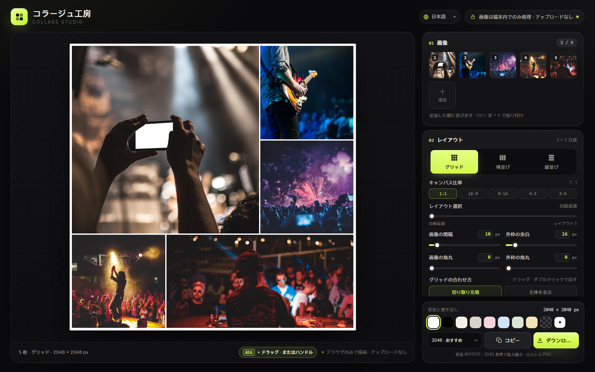

# コラージュ工房 · Collage Studio

[English](../README.md) · [简体中文](README.zh-CN.md) · **日本語** · [한국어](README.ko.md) · [Español](README.es.md) · [Deutsch](README.de.md) · [Français](README.fr.md)

**ブラウザだけで動く、依存ゼロ**のコラージュ作成ツール。`index.html`、`styles.css`、`app.js`、`i18n.js` の4つの静的ファイルで構成され、`index.html` を開くだけで使えます。インストールもビルドも不要で、画像が端末の外に出ることはありません。



## 作例

いずれも 1600 px 長辺・既定設定での実際の書き出し例です。

<div align="center">
<table>
  <tr>
    <td align="center" valign="top"><br><sub><b>グリッド · 1:1</b></sub></td>
    <td align="center" valign="top"><br><sub><b>グリッド · 16:9</b></sub></td>
  </tr>
</table>
</div>

<p align="center"><br><sub><b>横並び</b></sub></p>

## レイアウトの違い（1:1）

同じ 5 枚・正方形キャンバスで、「レイアウト選択」スライダーにより候補を切り替えられます。

<div align="center">
<table>
  <tr>
    <td align="center" valign="top"><a href="images/example-layout-auto.jpg"></a><br><sub><b>自動最適</b></sub></td>
    <td align="center" valign="top"><a href="images/example-layout-1.jpg"></a><br><sub><b>レイアウト 1</b></sub></td>
    <td align="center" valign="top"><a href="images/example-layout-2.jpg"></a><br><sub><b>レイアウト 2</b></sub></td>
    <td align="center" valign="top"><a href="images/example-layout-3.jpg"></a><br><sub><b>レイアウト 3</b></sub></td>
  </tr>
</table>
</div>

## 使い方

1. Chrome / Edge で `index.html` を開きます（4つのファイルは同じフォルダに置いてください）。
2. 画像を最大 **9 枚**追加します。「画像を選択」、ページへのドラッグ、`Ctrl / ⌘ + V` での貼り付けに対応。
3. レイアウトを選びます：**グリッド**、**横並び**、**縦並び**。グリッドではキャンバス比率 `1:1 / 16:9 / 9:16 / 4:3 / 3:4` も選べます。
4. 画像の間隔、外枠の余白、画像の角丸、外枠の角丸、背景色を調整します。グリッドでは画像をドラッグして表示範囲を選び、ダブルクリックで中央に戻ります。
5. 「コピー」で PNG をクリップボードへ、「ダウンロード」でファイルを保存します。

サムネイルはドラッグで並べ替え、ホバー時の `‹` `›` で移動、`×` で1枚削除できます。

## 機能

- **3つのレイアウト** — グリッドは 1–9 枚に対応する 3×3 結合テンプレートを使い、常にキャンバスを埋める「1枚大きく＋数枚小さく」の雑誌風構図になります。横並びは1行、縦並びは1列で、どちらも画像自身の縦横比で拡大縮小し、切り取りません。
- **5種類のキャンバス比率** — `1:1 / 16:9 / 9:16 / 4:3 / 3:4`。長辺が固定なので、2048 px は 16:9 で 2048 × 1152、9:16 で 1152 × 2048 になります。
- **レイアウト選択** — スライダー `0` は自動最適、`1–5` は切り取り保持率で並べた別レイアウト。並べ替えてもレイアウトは変わらず、画像の追加・削除やスライダー操作のときだけ再計算します。
- **並べ替え** — 各セルの右上にハンドルがあります。ポインタがキャンバスに入ると全て表示され、離れると1秒後にフェードアウト。初回は5秒表示、タッチではタップで1秒表示。ハンドルをドラッグするか、デスクトップでは `Alt` + セルのドラッグで入れ替えられます。
- **リアルタイムプレビュー** — ダークなステージ。透明背景はグレーの市松模様で表示し、キャンバスに 1 px の輪郭（プレビューのみ、書き出しには含まれません）。
- **プライバシー** — すべてブラウザ内で完結。通信・アップロード・外部スクリプトはありません。

## パラメータ

| 設定 | 範囲 | 説明 |
|---|---|---|
| 画像の間隔 | `0–120 px` | 画像どうしの間隔 |
| 外枠の余白 | `0–160 px` | キャンバス端から画像までの実際の余白。間隔は加算されません |
| 画像の角丸 | `0–120 px` | セルの半分を超えると自動的に抑えられます |
| 外枠の角丸 | `0–240 px` | コラージュ全体の外枠の角丸。外側は透明で書き出し |
| 背景色 | 既定は白 | 8つのプリセット、カスタム色、透明 |
| グリッドの合わせ方 | 切り取り充填 / 全体を表示 | 切り取り時はドラッグで位置を調整、ダブルクリックで戻す |

すべての数値は直接入力でき（`Enter` またはフォーカスを外すと反映）、スライダーと双方向に同期し、範囲外は自動的に収まります。

## 書き出し

長辺 **1200 / 1600 / 2048 / 2560 / 3072 / 4096 px**、ロスレス PNG。クリップボードへコピーするかファイルとして保存でき、透明背景と外枠の角丸の外側は透明のまま残ります。

`1200` チャット · `1600` Web · `2048` おすすめ · `2560` 2K · `3072` 印刷 · `4096` ポスター

> コピーはブラウザの Clipboard API に依存します。未対応・未許可の場合は「ダウンロード」をご利用ください。

## 単位

間隔・余白・角丸は **2048 px の長辺**を基準にし、書き出しサイズに合わせて同じ比率で拡大縮小されます。そのため構図はどの解像度でも同じで、出力サイズだけが変わります。基準 `16 px` の外枠の余白は、4096 px で `32 px`、1200 px で約 `9.4 px` になります。

## ファイル構成

```
index.html   # ページ構造
styles.css   # すべてのスタイル
i18n.js      # 多言語の文言（中 / 英 / 日 / 韓 / 西 / 独 / 仏）
app.js       # レイアウト、描画、操作、書き出し
docs/        # 言語別 README とスクリーンショット
```
