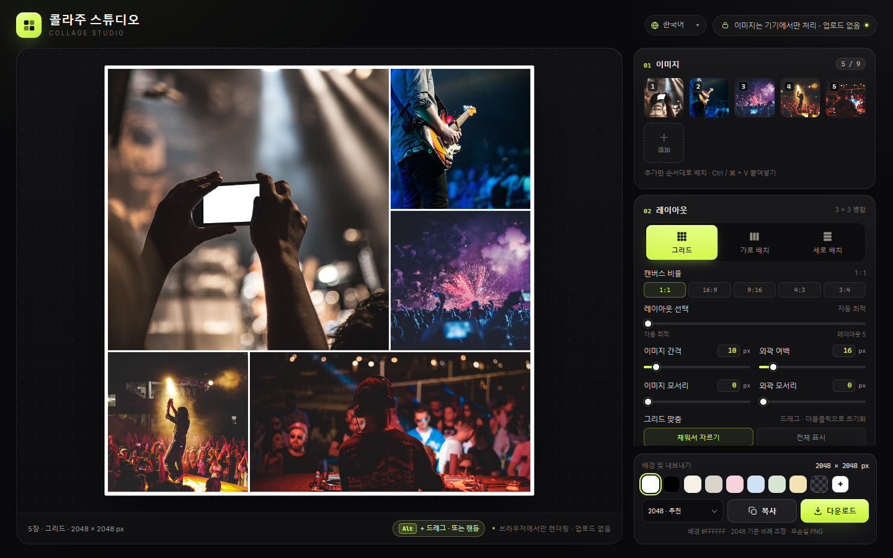

# 콜라주 스튜디오 · Collage Studio

[English](../README.md) · [简体中文](README.zh-CN.md) · [日本語](README.ja.md) · **한국어** · [Español](README.es.md) · [Deutsch](README.de.md) · [Français](README.fr.md) · [Português](README.pt.md) · [العربية](README.ar.md)

**브라우저에서만 동작하는, 의존성 없는** 콜라주 도구입니다. `index.html`, `styles.css`, `app.js`, `i18n.js` 네 개의 정적 파일로 이루어져 있고, `index.html`을 열면 바로 사용할 수 있습니다. 설치와 빌드가 필요 없으며 이미지는 기기 밖으로 나가지 않습니다.

**온라인 체험:** [https://collage.stevenpub.com](https://collage.stevenpub.com)



## 예시

모두 1600 px 긴 변, 기본 설정으로 실제 내보낸 예시입니다.

<div align="center">
<table>
  <tr>
    <td align="center" valign="top"><br><sub><b>그리드 · 1:1</b></sub></td>
    <td align="center" valign="top"><br><sub><b>그리드 · 16:9</b></sub></td>
  </tr>
</table>
</div>

<p align="center"><br><sub><b>가로 배치</b></sub></p>

## 레이아웃 비교 (1:1)

같은 5장, 정사각형 캔버스에서 「레이아웃 선택」 슬라이더로 후보를 바꿀 수 있습니다.

<div align="center">
<table>
  <tr>
    <td align="center" valign="top"><a href="images/example-layout-auto.jpg"></a><br><sub><b>자동 최적</b></sub></td>
    <td align="center" valign="top"><a href="images/example-layout-1.jpg"></a><br><sub><b>레이아웃 1</b></sub></td>
    <td align="center" valign="top"><a href="images/example-layout-2.jpg"></a><br><sub><b>레이아웃 2</b></sub></td>
    <td align="center" valign="top"><a href="images/example-layout-3.jpg"></a><br><sub><b>레이아웃 3</b></sub></td>
  </tr>
</table>
</div>

## 사용법

1. Chrome / Edge에서 `index.html`을 엽니다(네 파일은 같은 폴더에 두세요).
2. 이미지를 최대 **9장** 추가합니다. 「이미지 선택」, 페이지로 끌어다 놓기, `Ctrl / ⌘ + V` 붙여넣기를 지원합니다.
3. 레이아웃을 고릅니다: **그리드**, **가로 배치**, **세로 배치**. 그리드에서는 캔버스 비율 `1:1 / 16:9 / 9:16 / 4:3 / 3:4`도 선택할 수 있습니다.
4. 이미지 간격, 외곽 여백, 이미지 모서리, 외곽 모서리, 배경색을 조절합니다. 그리드에서는 이미지를 끌어 보이는 영역을 고르고, 더블클릭하면 가운데로 돌아갑니다.
5. 「복사」로 PNG를 클립보드에 넣거나 「다운로드」로 파일을 저장합니다.

썸네일은 끌어서 정렬하고, 호버 시 `‹` `›`로 이동하며, `×`로 한 장씩 삭제할 수 있습니다.

## 기능

- **세 가지 레이아웃** — 그리드는 1–9장에 대응하는 3×3 병합 템플릿을 사용해 항상 캔버스를 채우는 「큰 이미지 하나 + 작은 이미지 여러 개」의 잡지식 구성을 만듭니다. 가로 배치는 한 줄, 세로 배치는 한 열이며 둘 다 이미지 자체의 비율로 확대·축소하고 자르지 않습니다.
- **다섯 가지 캔버스 비율** — `1:1 / 16:9 / 9:16 / 4:3 / 3:4`. 긴 변이 고정되므로 2048 px는 16:9에서 2048 × 1152, 9:16에서 1152 × 2048이 됩니다.
- **레이아웃 선택** — 슬라이더 `0`은 자동 최적, `1–5`는 잘라내기 유지율 순서의 다른 레이아웃입니다. 순서를 바꿔도 레이아웃은 유지되며, 이미지를 추가·삭제하거나 슬라이더를 움직일 때만 다시 계산합니다.
- **순서 변경** — 각 셀 오른쪽 위에 핸들이 있습니다. 포인터가 캔버스에 들어오면 모두 보이고 벗어나면 1초 후 사라집니다. 첫 방문에는 5초, 터치에서는 탭하면 1초 보입니다. 핸들을 끌거나 데스크톱에서 `Alt` + 셀 드래그로 자리를 바꿉니다.
- **실시간 미리보기** — 어두운 작업 공간. 투명 배경은 회색 체크무늬로 표시하고 캔버스에 1 px 테두리(미리보기 전용, 내보내기에는 미포함).
- **개인정보** — 모든 처리가 브라우저 안에서 끝납니다. 네트워크 요청·업로드·외부 스크립트가 없습니다.

## 파라미터

| 설정 | 범위 | 설명 |
|---|---|---|
| 이미지 간격 | `0–120 px` | 이미지 사이의 간격 |
| 외곽 여백 | `0–160 px` | 캔버스 가장자리에서 이미지까지의 실제 여백. 간격이 더해지지 않습니다 |
| 이미지 모서리 | `0–120 px` | 셀의 절반을 넘으면 자동으로 줄어듭니다 |
| 외곽 모서리 | `0–240 px` | 콜라주 전체 외곽의 둥글기. 바깥은 투명으로 내보냄 |
| 배경색 | 기본 흰색 | 프리셋 8종, 사용자 지정 색, 투명 |
| 그리드 맞춤 | 채워서 자르기 / 전체 표시 | 자를 때는 끌어서 위치 조정, 더블클릭으로 초기화 |

모든 숫자는 직접 입력할 수 있고(`Enter` 또는 포커스 아웃 시 적용), 슬라이더와 양방향 동기화되며 범위를 벗어나면 자동으로 맞춰집니다.

## 내보내기

긴 변 **1200 / 1600 / 2048 / 2560 / 3072 / 4096 px**, 무손실 PNG. 클립보드로 복사하거나 파일로 저장할 수 있으며, 투명 배경과 외곽 모서리 바깥 영역은 투명으로 유지됩니다.

`1200` 채팅 · `1600` 웹 · `2048` 추천 · `2560` 2K · `3072` 인쇄 · `4096` 포스터

> 복사는 브라우저 Clipboard API에 의존합니다. 지원되지 않거나 권한이 없으면 「다운로드」를 사용하세요.

## 단위

간격·여백·모서리는 **2048 px 긴 변**을 기준으로 하며 내보내기 크기에 맞춰 같은 비율로 조정됩니다. 따라서 구도는 어느 해상도에서나 같고 출력 크기만 달라집니다. 기준 `16 px`의 외곽 여백은 4096 px에서 `32 px`, 1200 px에서 약 `9.4 px`가 됩니다.

## 파일 구조

```
index.html   # 페이지 구조
styles.css   # 모든 스타일
i18n.js      # 다국어 문구(중 / 영 / 일 / 한 / 서 / 독 / 불)
app.js       # 레이아웃, 렌더링, 상호작용, 내보내기
docs/        # 언어별 README와 스크린샷
```
