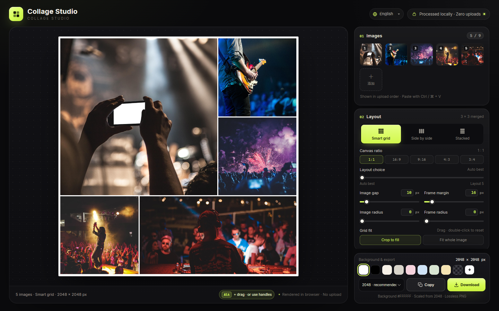

# Collage Studio

[English](../README.md) · [简体中文](README.zh-CN.md) · [日本語](README.ja.md) · [한국어](README.ko.md) · [Español](README.es.md) · [Deutsch](README.de.md) · [Français](README.fr.md) · **Português** · [العربية](README.ar.md)

Um criador de colagens **só no navegador e sem dependências**, feito com quatro arquivos estáticos (`index.html`, `styles.css`, `app.js`, `i18n.js`). Abra `index.html` para usar — sem instalação, sem build, sem upload. As imagens nunca saem do seu dispositivo.

**Experimentar online:** [https://collage.stevenpub.com](https://collage.stevenpub.com)



## Exemplos

Exportações reais com a borda longa de 1600 px e as definições padrão.

<div align="center">
<table>
  <tr>
    <td align="center" valign="top"><br><sub><b>Grelha inteligente · 1:1</b></sub></td>
    <td align="center" valign="top"><br><sub><b>Grelha inteligente · 16:9</b></sub></td>
  </tr>
</table>
</div>

<p align="center"><br><sub><b>Lado a lado</b></sub></p>

## Layouts (1:1)

Cinco imagens, uma tela quadrada — escolha qualquer candidato com o controle **Escolha de layout**.

<div align="center">
<table>
  <tr>
    <td align="center" valign="top"><a href="images/example-layout-auto.jpg"></a><br><sub><b>Melhor automático</b></sub></td>
    <td align="center" valign="top"><a href="images/example-layout-1.jpg"></a><br><sub><b>Layout 1</b></sub></td>
    <td align="center" valign="top"><a href="images/example-layout-2.jpg"></a><br><sub><b>Layout 2</b></sub></td>
    <td align="center" valign="top"><a href="images/example-layout-3.jpg"></a><br><sub><b>Layout 3</b></sub></td>
  </tr>
</table>
</div>

## Começar

1. Abra `index.html` no Chrome / Edge (mantenha os quatro arquivos na mesma pasta).
2. Adicione até **9 imagens**: clique em **Escolher imagens**, arraste fotos para a página ou cole com `Ctrl / ⌘ + V`.
3. Escolha um layout — **Grelha inteligente**, **Lado a lado** ou **Empilhado**. A grelha também oferece as proporções `1:1 / 16:9 / 9:16 / 4:3 / 3:4`.
4. Ajuste o intervalo, a margem da moldura, o raio das imagens, o raio da moldura e o fundo. Na grelha, arraste uma imagem para escolher o recorte, ou clique duas vezes para recentrar.
5. Clique em **Copiar** para colocar o PNG na área de transferência, ou em **Baixar** para guardar.

As miniaturas reordenam-se ao arrastar, com `‹` `›` ao pairar, ou com `×` para remover uma.

## Funcionalidades

- **Três layouts** — A grelha inteligente usa modelos 3×3 fundidos para 1–9 imagens e enche sempre a tela, com uma composição de revista: uma grande e várias pequenas. Lado a lado e Empilhado colocam as imagens numa linha ou coluna, na proporção original, sem recorte.
- **Cinco proporções** — `1:1 / 16:9 / 9:16 / 4:3 / 3:4`. A borda longa fica fixa: 2048 px dá 2048 × 1152 em 16:9 e 1152 × 2048 em 9:16.
- **Escolha de layout** — o controle `0` é o melhor automático; `1–5` são outros layouts ordenados pela área conservada. Reordenar imagens não muda o layout; adicionar ou remover imagens, ou mover o controle, recalcula.
- **Reordenar** — cada célula tem uma pega no canto superior direito. Todas aparecem quando o ponteiro entra na tela e desaparecem 1 s depois de sair; na primeira visita ficam 5 s, e um toque mostra-as por 1 s. Arraste uma pega ou, no computador, segure `Alt` e arraste uma célula.
- **Pré-visualização ao vivo** — palco escuro, fundos transparentes como um xadrez cinzento, contorno de 1 px na tela (só na pré-visualização, nunca na exportação).
- **Privacidade** — tudo corre no navegador: sem pedidos de rede, sem uploads, sem scripts de terceiros.

## Parâmetros

| Definição | Intervalo | Notas |
|---|---|---|
| Intervalo | `0–120 px` | Espaço entre imagens |
| Margem da moldura | `0–160 px` | Distância real da borda da tela às imagens; não se soma meio intervalo |
| Raio da imagem | `0–120 px` | Limitado a metade da célula |
| Raio da moldura | `0–240 px` | Arredondamento de toda a colagem; o exterior é exportado transparente |
| Fundo | Branco por padrão | 8 predefinições, seletor personalizado, transparente |
| Ajuste da grelha | Recortar para encher / Mostrar inteira | Recorte: arraste para reposicionar, clique duas vezes para repor |

Todos os valores aceitam entrada direta (`Enter` ou sair do campo aplica), ficam sincronizados com os controles e limitam valores fora do intervalo.

## Exportar

Borda longa **1200 / 1600 / 2048 / 2560 / 3072 / 4096 px**, PNG sem perdas. Copie para a área de transferência ou baixe; a transparência e a área fora do raio da moldura são preservadas.

`1200` conversa · `1600` web · `2048` recomendado · `2560` 2K · `3072` impressão · `4096` cartaz

> Copiar precisa da Clipboard API do navegador. Se não existir ou estiver bloqueada, use **Baixar**.

## Unidades

Intervalo, margens e raios usam uma **borda longa de 2048 px** como base e escalam com o tamanho de exportação, por isso a composição é igual em qualquer resolução — só muda o tamanho de saída. Uma margem base de `16 px` passa a `32 px` em 4096 px e a cerca de `9,4 px` em 1200 px.

## Arquivos

```
index.html   # estrutura da página
styles.css   # todos os estilos
i18n.js      # textos da interface (zh / en / ja / ko / es / de / fr)
app.js       # layout, renderização, interação e exportação
preview.png  # pré-visualização social (interface em inglês)
docs/        # README por idioma e capturas
```
