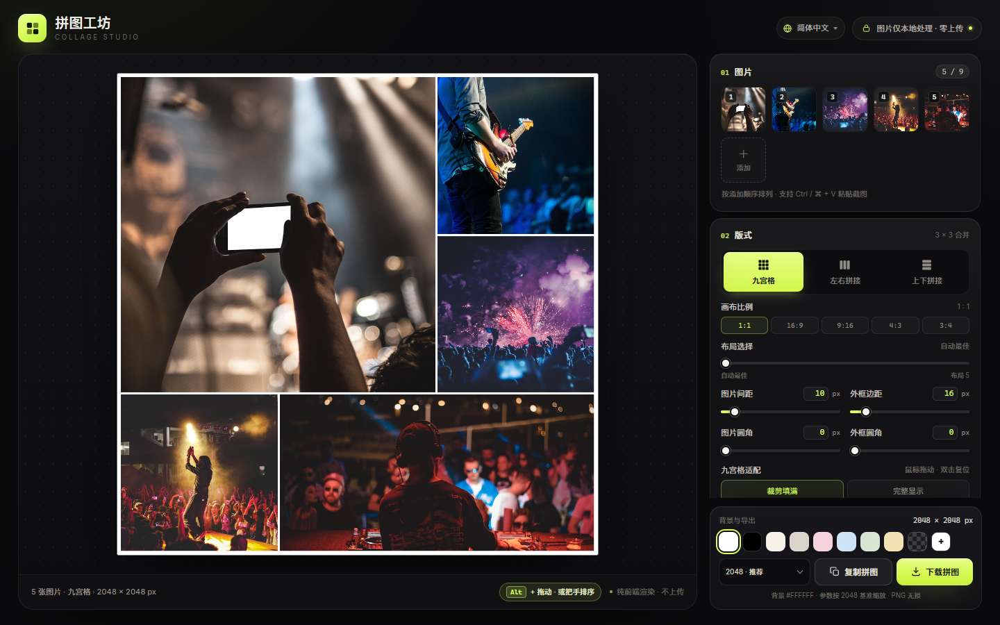

# 拼图工坊 · Collage Studio

[English](../README.md) · **简体中文** · [日本語](README.ja.md) · [한국어](README.ko.md) · [Español](README.es.md) · [Deutsch](README.de.md) · [Français](README.fr.md) · [Português](README.pt.md) · [العربية](README.ar.md)

一个**纯前端、零依赖**的拼图工具，由四个静态文件组成（`index.html`、`styles.css`、`app.js`、`i18n.js`）。双击 `index.html` 即可使用，无需安装、无需构建，图片不会离开你的设备。

**在线体验：** [https://collage.stevenpub.com](https://collage.stevenpub.com)



## 效果示例

以下均为 1600 px 长边的实际导出效果，使用默认参数。

<div align="center">
<table>
  <tr>
    <td align="center" valign="top"><br><sub><b>九宫格 · 1:1</b></sub></td>
    <td align="center" valign="top"><br><sub><b>九宫格 · 16:9</b></sub></td>
  </tr>
</table>
</div>

<p align="center"><br><sub><b>左右拼接</b></sub></p>

## 多种布局（1:1）

同样是 5 张图、方形画布，用「布局选择」滑块可以在不同候选布局间切换。

<div align="center">
<table>
  <tr>
    <td align="center" valign="top"><a href="images/example-layout-auto.jpg"></a><br><sub><b>自动最佳</b></sub></td>
    <td align="center" valign="top"><a href="images/example-layout-1.jpg"></a><br><sub><b>布局 1</b></sub></td>
    <td align="center" valign="top"><a href="images/example-layout-2.jpg"></a><br><sub><b>布局 2</b></sub></td>
    <td align="center" valign="top"><a href="images/example-layout-3.jpg"></a><br><sub><b>布局 3</b></sub></td>
  </tr>
</table>
</div>

## 快速开始

1. 用 Chrome / Edge 打开 `index.html`（四个文件放在同一目录）。
2. 添加最多 **9 张图片**：点击「选择图片」、把照片拖进页面，或按 `Ctrl / ⌘ + V` 粘贴。
3. 选择版式：**九宫格**、**左右拼接**、**上下拼接**。九宫格还可选画布比例 `1:1 / 16:9 / 9:16 / 4:3 / 3:4`。
4. 调整图片间距、外框边距、图片圆角、外框圆角和背景色。九宫格里拖动图片选择露出区域，双击恢复居中。
5. 点击「复制拼图」把 PNG 放进剪贴板，或点击「下载拼图」保存文件。

缩略图支持拖动排序、悬停时用 `‹` `›` 移动，点 `×` 删除单张。

## 功能

- **三种版式** — 九宫格用 1–9 张对应的 3×3 合并模板，始终铺满画布，形成一大几小的杂志式构图；左右拼接为单行、上下拼接为单列，都按图片自身宽高比缩放，不裁切。
- **五种画布比例** — `1:1 / 16:9 / 9:16 / 4:3 / 3:4`。长边固定，所以 2048 px 在 16:9 下输出 2048 × 1152，9:16 下输出 1152 × 2048。
- **布局选择** — 滑块 `0` 为自动最佳，`1–5` 为按裁剪保留率排序的其他布局。拖动排序不会改变布局；新增/删除图片或改变滑块时才重新计算。
- **画布排序** — 每个格子右上角有把手。鼠标进入画布区时全部显示，离开 1 秒后淡出；首次进入显示 5 秒，触屏轻点显示 1 秒。拖动把手换位，桌面端也可按住 `Alt` 拖动格子。
- **实时预览** — 深色工作台，透明背景显示为灰色棋盘格，画布带 1 px 描边（仅预览，不进入导出）。
- **隐私** — 全部处理在浏览器内完成：无网络请求、无上传、无第三方脚本。

## 参数

| 设置 | 范围 | 说明 |
|---|---|---|
| 图片间距 | `0–120 px` | 图片之间的间距 |
| 外框边距 | `0–160 px` | 画布边缘到图片的实际留白，不再额外叠加间距 |
| 图片圆角 | `0–120 px` | 超过格子一半时自动收敛 |
| 外框圆角 | `0–240 px` | 整个拼图外框的圆角，圆角外区域导出为透明 |
| 背景色 | 默认纯白 | 8 个预设、自定义取色、透明 |
| 九宫格适配 | 裁剪填满 / 完整显示 | 裁剪时可拖动改位置，双击复位 |

所有数值支持直接输入（`Enter` 或失焦生效），与滑块双向同步，超出范围自动收敛。

## 导出

长边 **1200 / 1600 / 2048 / 2560 / 3072 / 4096 px**，PNG 无损。可复制到剪贴板或下载；透明背景和外框圆角外的区域会保留透明通道。

`1200` 聊天 · `1600` 网页 · `2048` 推荐 · `2560` 2K · `3072` 打印 · `4096` 海报

> 复制依赖浏览器的 Clipboard API。不支持或被限制时，请使用「下载拼图」。

## 单位

间距、边距和圆角以 **2048 px 长边**为设计基准，并随导出尺寸等比缩放，因此构图在任何分辨率下都一致，只有输出尺寸变化。基准 `16 px` 的外框边距在 4096 px 下为 `32 px`，在 1200 px 下约为 `9.4 px`。

## 文件结构

```
index.html   # 页面结构
styles.css   # 全部样式
i18n.js      # 多语言文案（中 / 英 / 日 / 韩 / 西 / 德 / 法）
app.js       # 布局、渲染、交互与导出
preview.png  # 社交预览图（英文界面）
docs/        # 各语言 README 与对应界面截图
```
